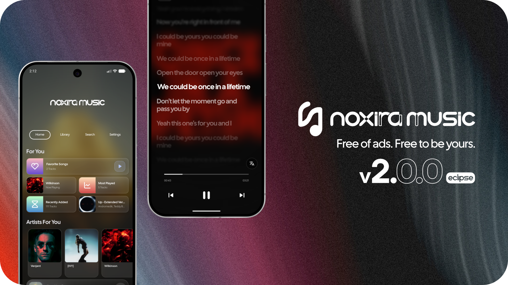
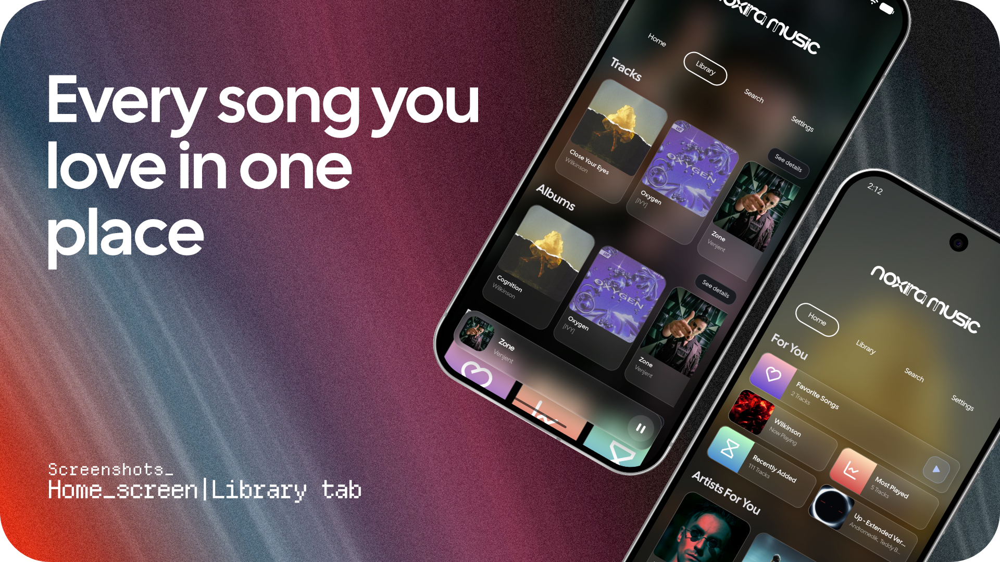
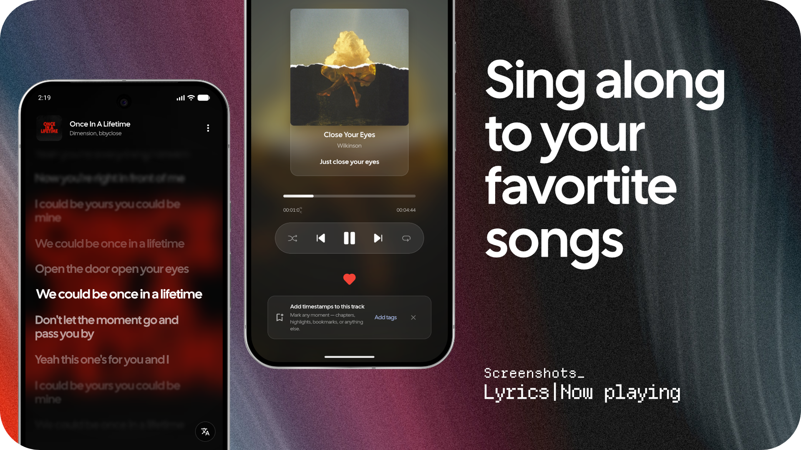
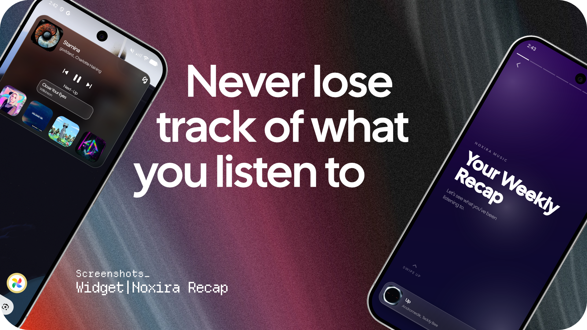
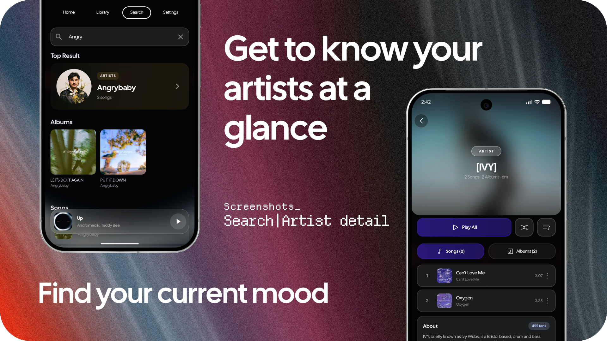
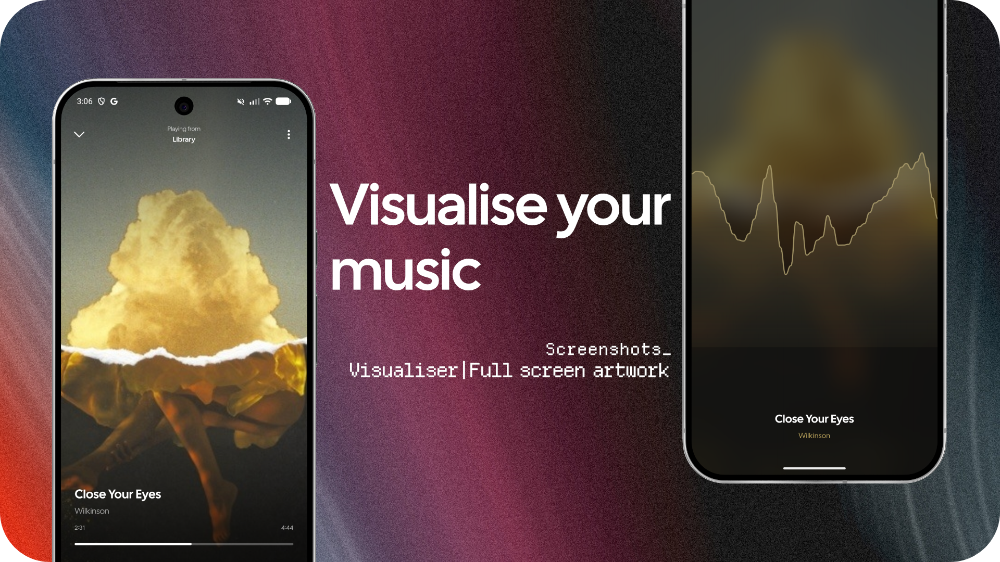

  

  
   
  <strong>Free of ads. Free to be yours.</strong>

A beautiful, fast, offline-first music player for Android. With synced lyrics, visualiser, powerful playback tools and a design that adapts to your music.

 

 

 

[Website](https://aurorasoftware.netlify.app) · [Google Play](https://play.google.com/store/apps/details?id=com.aurorasoftware.music) · [Instagram](https://www.instagram.com/aurora.software)

---

## ✦ About Noxira

Noxira started in October 2024 with a simple idea: music stored on your phone deserves a player that feels as good as the streaming apps — without an account, subscription or advertisements.

After more than a year of development and testing with beta users, the project reached its first stable release. It is still independently developed and maintained by one person.

**Version 2.0 marks a new chapter:** Aurora Music became **Noxira Music**, with a new name, wordmark, app icon and visual identity.

<strong>Why the name changed</strong>

Aurora Music was the original name of the project. As the app grew, it became increasingly difficult to distinguish it from other music players with the same name. Noxira gives the project a more distinctive identity while Aurora Software CZ remains the name behind its development.

---

## ◈ Screenshots

  
  
  

  
  

---

## ✧ What's new in 2.0

| Update | Details |
|:--|:--|
| **A new identity** | Noxira name, wordmark, app icon and animated splash screen. |
| **Lyrics translation** | Translate lyrics into any language, not only the app's interface languages. |
| **More lyric sources** | BetterLyrics, YouLyPlus and KuGou are tried when LRCLIB has no result. Choose your sources in Settings. |
| **Redesigned lyrics** | Tap a line to seek, see instrumental-break markers and follow lyrics from the Now Playing screen. |
| **A new home-screen widget** | Artwork-tinted glass design with playback controls that work without opening the app. |
| **A better queue** | See previously played and upcoming tracks, drag to reorder, swipe to remove and preview what's next. |
| **Playlist improvements** | A redesigned add-to-playlist sheet and a tool to remove duplicate tracks. |
| **Adaptive visual effects** | Glass surfaces, caches and transitions adapt to device capabilities, with simpler surfaces on lower-end phones. |
| **Smoother navigation** | Faster detail pages and artwork transitions between tracks, albums, artists, folders and playlists. |
| **WAV support** | WAV tags supported in the tag editor and player. |

---

## ❖ Features

### The interface

- **Material You colours** from your wallpaper or current album artwork, plus ten built-in themes: Aurora, Midnight, Ocean, Teal, Forest, Neon, Gold, Ember, Rose and Sakura.
- A custom **Now Playing** screen with artwork-driven backgrounds.
- A mini-player that smoothly expands into the full player with a tap or swipe.
- Two interface modes — high-end and lightweight — with setup recommendations based on your phone.

### Lyrics that move with the music

- Time-synced lyrics from `.lrc` files or embedded lyrics tags, available offline.
- Online lyric lookup when no local lyrics are available.
- Fullscreen lyrics and translation.
- A built-in **lyrics editor**: paste text and tap along to stamp timestamps, or import an `.lrc` file.

### Your library, your way

- Browse **Tracks, Albums, Artists and Folders**, search across your library and pull down to refresh.
- Include or exclude folders from your library.
- Split combined artist tags such as `A & B` using your own rules.
- Edit title, artist, album, genre, track number and artwork for MP3, FLAC, M4A, Ogg, Opus and WAV.
- Create playlists, drag to reorder tracks, and import or export **M3U / M3U8** playlists.
- Keep your favourites in one place.

### Smart tools

- **Smart playlists** built around your own rules, with match-all or match-any logic, optional limits and live match counts.
- **Track tags** for chapters, highlights and bookmarks inside long tracks — useful for DJ sets and mixes. Paste timestamps to import them.
- **Share as clip** to cut out a section of a track and save or share it.
- Listening suggestions: For You, suggested artists, recently added, recently played and most played.
- **Listening Insights** and **Listening Recap** based on actual listening time, including your top tracks, artists and genres.

### Playback and sound

- Crossfade with adjustable duration and an **Automix** option.
- A 5-band **equalizer** with presets and custom profiles.
- **ReplayGain** support for MP3, FLAC, Ogg Vorbis/Opus and MP4/M4A/AAC/ALAC.
- Playback speed up to 2.0×, sleep timer and saved queue.
- Four visualizer modes: bar spectrum, circular bars, mirror bars and frequency line.

### Built for everyday listening

- **Android Auto** support.
- Media notification and lock-screen controls.
- Bluetooth playback handling.
- Home-screen playback widget.
- Available in English, Czech, German, Spanish, Hindi and Russian.

---

## ⇩ Get Noxira

| | |
|:--|:--|
| **Platform** | Android |
| **Minimum version** | Android 10 (API 29) |
| **Price** | Free |
| **Account required** | No |
| **Advertisements** | None |

---

## ♥ Support independent development

Noxira is free to use and independently developed in my spare time. If it has earned a place on your phone, a small contribution helps cover the time and costs behind keeping it maintained — and ad-free.

A monthly support goal appears in the app from time to time and is always available under **Settings → About**. A rating or review on Google Play also makes a real difference.

Thank you for supporting independent development.

---

## ◉ Privacy

Your music library stays on your device. Noxira only connects to the internet for features such as lyrics, artist information and lyric translation. For artist information, only the artist name is sent.

The first-run setup explains the app's data practices. Noxira uses Firebase (Analytics, Crashlytics and Performance) and Sentry for anonymous usage, performance and crash reporting, helping identify and fix issues.

Permissions are used for audio-file access, notifications, background playback, Bluetooth functionality and the microphone access required by the visualizer.

Read the [Terms](https://aurorasoftware.netlify.app/terms.html) for more information.

---

## ↗ Follow the project

---

## License

Noxira Music is open-source software released under the **GNU General Public License v3.0**. See [LICENSE](LICENSE) for the full license text.

  © D4v31x / Aurora Software CZ
   
  Made independently in the Czech Republic.

